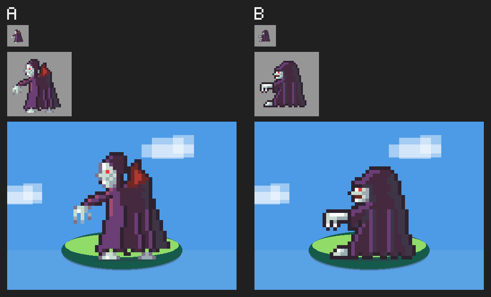
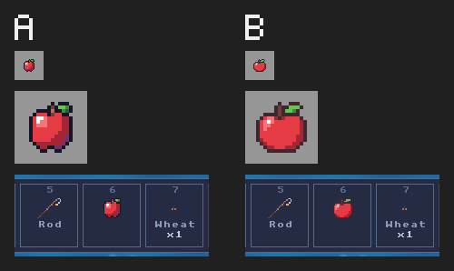

# Blind sheet: the pixel-draw trial

Each subject was drawn two different ways, A and B. For each subject, pick the one you would rather ship. Look
only at this page until both picks are in, because the other files in this folder name the methods.

Each picture shows A on the left and B on the right. From the top, each drawing is shown at 1×, at 4×, and in
place at the game's 1280×800.

## Strigoi

A MateQuest enemy, drawn at 32 px in MateQuest's colours. In place, it stands on the enemy platform of the combat
screen, at 8×.

## Apple icon

A Farm inventory icon, drawn at 16 px in EDG32. In place, it sits in slot 6 of Farm's hotbar, at the hotbar's
26 px.

## Your answer

Strigoi: A or B. Apple icon: A or B.

A and B were assigned at random for each subject, and the order was sealed in `sealed-order.txt` before this page
was made.
